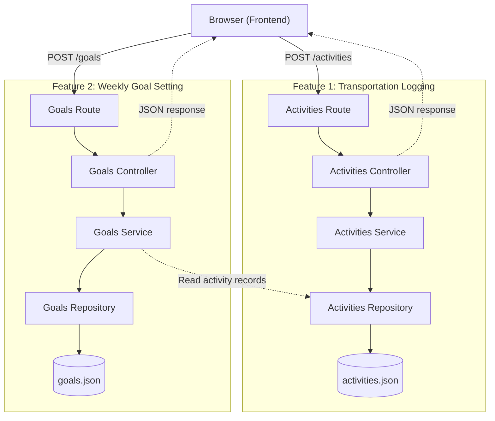

# cs326_team15

## Team Member

| Name                  | GitHub Username                                |
| :-------------------- | :--------------------------------------------- |
| Seoyeon Eom           | [@seoyeonEom](https://github.com/seoyeonEom)   |
| Agustin Pemberton     | [@ampemb](https://github.com/ampemb)           |
| Sally Vakhtangishvili | [@Salikuna](https://github.com/Salikuna)       |
| Willow Taylor         | [@RaineWillow](https://github.com/RaineWillow) |

## Working Agreement

- **Communication Cadence:** Primary communication will occur on WhatsApp, with team members agreeing to respond on the same day (within 12 hours) on weekdays and within 2 hours on sprint milestone due dates.
- **Meeting Schedule:** We will hold a weekly sync meeting (virtual or in-person) to review sprint progress, allocate tasks, and resolve blockers.
- **Definition of "Done" for PRs:** All work must be done on separate feature branches. A PR is considered done only after resolving conflicts and receiving at least 1 approving peer review before merging to `main`.

* **Decision Making & Conflict Resolution:** Technical or design disagreements will be discussed during sync meetings by evaluating pros, cons, and project scope. If consensus cannot be reached, the decision will be made by a team majority vote.

## Project Domain

Our project is a gamified carbon footprint tracker that helps university students monitor and reduce their daily environmental impact. Using open APIs to track carbon intensity over time, the application provides interactive daily tracking and visual impact graphs. By turning emissions data into actionable goals, the platform fosters sustainable campus habits and active climate awareness beyond the classroom.

## Getting Started

Follow these steps to run the application locally.

**Prerequisites:** **Node.js** and **npm**. If needed, install the LTS version from [nodejs.org](https://nodejs.org/).

1. Clone the repository

   ```bash
   git clone https://github.com/seoyeonEom/cs326_team15.git
   cd cs326_team15
   ```

2. Install dependencies

   ```bash
   npm install
   ```

3. Start the Express server from the project root

   ```bash
   npm start
   ```

4. Access the application
   - **Home page:** [http://localhost:3000](http://localhost:3000)
   - **Dashboard:** [http://localhost:3000/dashboard](http://localhost:3000/dashboard)
   - **Transportation Activities:** [http://localhost:3000/activities](http://localhost:3000/activities)

## Sprint 2 Features

### 1. Transportation Activity Logging

Students can record a transportation activity and see its estimated carbon emissions.

**How to use:**

1. Visit http://localhost:3000/activities.
2. Choose a date and transportation method (`walking`, `cycling`, `bus`, or `car`).
3. Enter a positive distance and select `km` or `mi`.
4. Click **Save activity**.
5. View the saved activity and emissions estimate in **Saved Activities**. Reload the page to see the saved records again.

**Validation and persistence:** The service validates user input and calculates estimated emissions. Activities are saved in data/activities.json, and invalid requests return a 400 response with an error message.

**Emissions calculation:** Estimated emissions are calculated based on transportation method and distance, using illustrative emission factors.

### 2. Weekly Goal Setting

Students can set a weekly transportation goal and track their progress based on saved activities.

**How to use:**

1. Visit /goals.
2. Select a week, transportation method, and target number of days.
3. Click Save Goal.
4. View the saved goal and progress based on matching transportation activities.
5. Reload the page to view the saved goal and updated progress.

The service validates the input and prevents duplicate goals for the same week and transportation method. Goals are saved in data/goals.json. Multiple activities on the same day count as one day toward the goal.

## System Diagram



### 3. Transportation Emissions Breakdown

Students can filter their saved transportation activities by method
(walking, cycling, bus, or car) and view the total estimated CO2
emissions and number of activities for the selected method.

**How to use:**
1. Visit http://localhost:3000/activities.
2. Scroll to Transportation Emissions Breakdown.
3. Select a transportation method or choose All Transportation.
4. View the updated total emissions, activity count, and filtered
   activity records.

**Implementation:**
- GET /activities/breakdown returns the emissions summary.
- An optional method query parameter filters the activities.
- The service validates the method and calculates total emissions.
- Invalid methods receive a 400 response.
- The frontend updates the breakdown without reloading the page.

## Design Decisions

**Seoyeon Eom**: For Transportation Activity Logging, I decided to keep input validation and carbon emission calculations in the service layer rather than the controller. An alternative would have been to handle these operations directly in the controller, which would have been simpler for a small application. However, separating the business logic from HTTP request handling makes the code easier to maintain and reuse. For example, if we add other ways to log activities in future sprints, we can reuse the same validation and calculation logic without duplicating it in different controllers. Although this approach requires more files and a slightly more complex structure, I think it is a better choice for our project's future development.

**Sally Vakhtangishvili:** For the Transportation Emissions Breakdown feature, I chose to implement filtering and emissions aggregation in the service layer rather than calculating these values directly in the frontend. An alternative would have been to retrieve all activities and use browser-side JavaScript to filter and sum their emissions. While that approach would have avoided creating a new API endpoint, keeping the calculations in the service layer ensures that the same business logic can be reused by other parts of the application, including the dashboard. It also allows the backend to validate the transportation method consistently and return a clear error for invalid requests. This introduces an additional endpoint but makes the functionality easier to maintain and extend.

**Willow Taylor:** Part of why I chose the date input is because Firefox doesn't support week inputs and shows a plain text box, so you'd have to type it by hand. And you'd still have to parse the string anyways, and there are a bunch of edge cases around New Year and a few other things, so the other option is best for my peace of mind. Also, snapping to monday means that you always get the same goals if you pick days in the same week. The rule successfully applies to any client, not only the form I cobbled together from looking a other commits. Dates are UTC midnight universally because of the potential difference between the server and client timezones. Checking whether an activity falls in a goal's week is a string comparison, so it's kind of simple.
